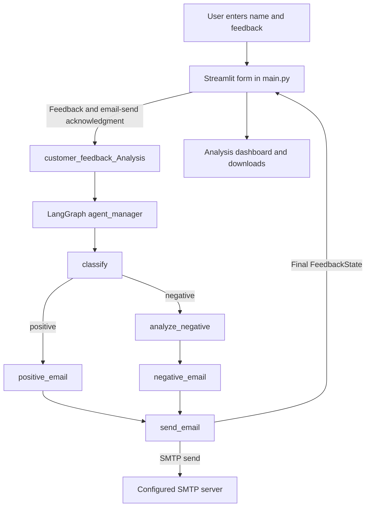
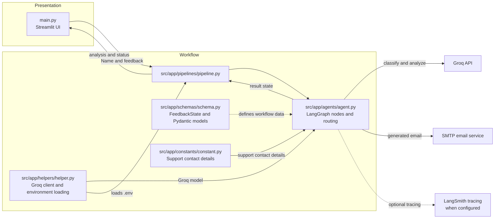

# Customer Feedback AI

A Streamlit application that classifies customer feedback, analyzes complaints, drafts a customer-support email, and sends that email through an SMTP server. LangGraph routes positive and negative feedback through the appropriate processing steps, while a Groq language model produces structured results.

The application helps demonstrate how an AI workflow can turn a feedback message into a sentiment result, a complaint analysis when needed, and a generated support email. It is an interactive demo, not a fully configurable production service: the current pipeline uses a fixed email recipient, and submitting the form can send a real email.

## Table of Contents

- [Project Overview](#project-overview)
- [Prerequisites](#prerequisites)
- [Installation on Windows](#installation-on-windows)
- [Configuration and Dependencies](#configuration-and-dependencies)
- [Running the Application](#running-the-application)
- [How to Use the Application](#how-to-use-the-application)
- [Application Workflow — From User Input to Final Output](#application-workflow-from-user-input-to-final-output)
- [Project Architecture — How Components Work Together](#project-architecture-how-components-work-together)
- [Execution Sequence — Step-by-Step Processing](#execution-sequence-step-by-step-processing)
- [Project Structure and Code Organization](#project-structure-and-code-organization)
- [Troubleshooting](#troubleshooting)

## Project Overview

The app accepts a customer's name and feedback in a Streamlit form. A LangGraph workflow sends the feedback to a Groq model for sentiment classification:

- **Positive feedback** goes to a thank-you email drafting step.
- **Negative feedback** is analyzed for issue category, tone, severity, summary, and a suggested next action, then goes to an empathetic support-email drafting step.
- **Both branches** send the generated email through the configured SMTP service and return the workflow state to the UI.

The UI displays the sentiment and analysis, previews the generated email, reports the sender node's status, and offers downloads of the email body and complete result as JSON. The displayed `sent` status means the SMTP sender completed without raising an error; it does not confirm inbox delivery.

### Key technologies

- **Python 3.13 or later** for the application.
- **Streamlit** for the browser-based interface.
- **LangGraph** for graph-based processing and conditional routing.
- **LangChain Groq** for structured language-model output.
- **Pydantic** for validating sentiment, analysis, and email-draft data.
- **SMTP** for sending the generated customer email.
- **uv** for synchronizing dependencies and running commands in the project environment.

## Prerequisites

You will need:

- Windows 10 or later with PowerShell.
- Python 3.13 or later.
- Git.
- uv.
- A Groq API key.
- SMTP server credentials for the account that will send email.

The project also declares an OpenAI integration helper, but the current graph uses Groq. An OpenAI key is not required to run the application as it is currently implemented.

## Installation on Windows

Run the following commands in PowerShell unless otherwise stated.

### 1. Install Python

1. Download Python from [python.org/downloads](https://www.python.org/downloads/).
2. Install Python 3.13 or later. In the installer, enable **Add python.exe to PATH** before selecting the install option.
3. Open a new PowerShell window and verify the installation:

   ```powershell
   python --version
   ```

   The reported version must be 3.13 or later. If `python` is not recognized, reopen PowerShell; if that does not help, rerun the installer and enable the PATH option.

### 2. Install Git

1. Download Git for Windows from [git-scm.com/downloads](https://git-scm.com/downloads).
2. Install it using the installer defaults.
3. Open a new PowerShell window and verify:

   ```powershell
   git --version
   ```

### 3. Install uv

uv is a Python project and package manager. This project uses it to install the versions resolved in `uv.lock` and run the app with its managed virtual environment, without requiring you to activate that environment manually.

In PowerShell, install uv using its Windows installer:

```powershell
powershell -ExecutionPolicy ByPass -c "irm https://astral.sh/uv/install.ps1 | iex"
```

Open a new PowerShell window and verify:

```powershell
uv --version
```

### 4. Clone the project

No Git remote URL is configured in this copy of the project. Replace the example URL below with the repository URL you have access to:

```powershell
git clone https://github.com/YOUR-USERNAME/YOUR-REPOSITORY.git
cd YOUR-REPOSITORY
```

Replace `YOUR-USERNAME` and `YOUR-REPOSITORY` with the values from your repository URL. The `cd` argument must match the directory created by `git clone`. Run the remaining commands from the project root (the directory containing `pyproject.toml` and `main.py`).

### 5. Synchronize project dependencies

`pyproject.toml` declares the project metadata, Python requirement, and direct dependencies. `uv.lock` records the resolved dependency versions so installations are consistent.

From the project root, run:

```powershell
uv sync
```

`uv sync` creates or updates the project's `.venv` and installs the dependencies declared by the project and lock file. You do not need to activate `.venv` before running the application.

## Configuration and Dependencies

### Required credentials and settings

The app loads environment variables from a `.env` file in the project root. A `.env.example` file is present as a reference. Before running the app, create or update `.env` with your own credentials. For example, in PowerShell:

```powershell
Copy-Item .env.example .env
```

Open `.env` in a text editor and replace **every existing value** with your own credentials. Do not run the app with example values or share your `.env` file. The project `.gitignore` excludes `.env` so local credentials are not accidentally committed.

| Variable | Required? | Purpose |
|---|---|---|
| `GROQ_API_KEY` | Yes | Authenticates the Groq model used by the graph. |
| `SMTP_HOST` | Yes | Hostname of the SMTP server used to send email. |
| `SMTP_USER` | Yes | SMTP login and sender address. |
| `SMTP_PASSWORD` | Yes | SMTP account password or provider-issued app password. |
| `SMTP_PORT` | No | SMTP port; defaults to `587`. The sender uses STARTTLS. |

Use the SMTP settings provided by your email service. For Gmail, an app password may be required instead of your normal account password. Keep all credentials private.

**Email delivery warning:** the Streamlit form asks you to acknowledge that a real email may be sent, but the current pipeline sets the recipient address in code rather than accepting it from the form. Review and update the `customer_email` value in `src/app/pipelines/pipeline.py` before using the app with real customer data. The email destination is not configurable through `.env` or the UI.

### Optional settings

The helper sets defaults for `GROQ_API_MODEL` (`openai/gpt-oss-20b`), `OPENAI_API_MODEL` (`gpt-4o`), `LANGSMITH_PROJECT` (`groq-chat-project`), and `LANGSMITH_TRACING` (`true`) when they are not already set. The current workflow uses the Groq model setting. LangSmith tracing can be configured with your own LangSmith credentials if you intend to use tracing; it is not required application input.

`OPENAI_API_KEY` is read only by the separate `get_openai_llm()` helper. The current graph does not call that helper, so the key is not required unless you adapt the workflow to use OpenAI.

### Important declared dependencies

| Package | Role in this project |
|---|---|
| `streamlit` | Renders the feedback form, results, and downloads. |
| `langgraph` | Builds and runs the conditional feedback workflow. |
| `langchain-groq` | Connects the active graph to Groq. |
| `langchain-openai` | Provides an OpenAI helper that is not used by the current graph. |
| `pydantic` | Defines structured model outputs and validates their fields. |
| `python-dotenv` | Loads environment variables from the project-root `.env` file. |
| `langsmith` | Provides LangChain/LangGraph tracing support when configured. |
| `certifi` | Supplies the CA certificate bundle used for HTTPS requests. |
| `rich` | Declared as a dependency; it is not directly used by the current UI or graph code. |

## Running the Application

From the project root, run:

```powershell
uv run streamlit run main.py
```

`main.py` is the Streamlit entry point. `uv run` executes Streamlit in the project's managed environment, so manual virtual-environment activation is unnecessary. Streamlit prints a local URL in the terminal (usually `http://localhost:8501`) when the app starts.

The only application mode currently provided is this Streamlit interface. There is no separate single-agent or multi-agent Streamlit entry point in the project.

## How to Use the Application

1. Configure your Groq and SMTP credentials in the project-root `.env` file and review the fixed recipient in the pipeline before running a real email workflow.
2. Start the app with `uv run streamlit run main.py`.
3. Open the **Local URL** printed in the terminal in your browser.
4. Enter the customer's name and feedback. The form has sample values that you can replace.
5. Select the acknowledgment checkbox to confirm that the workflow may send a real email, then click **Analyze Feedback & Run Workflow**.
6. Review the sentiment result. Negative feedback also includes a complaint category, tone, severity, summary, and recommended next action.
7. Review the generated email and delivery status. Download the email body or complete pipeline output if needed.

There is no human approval step after the checkbox. The graph attempts SMTP delivery as part of the same workflow run.

<a id="application-workflow-from-user-input-to-final-output"></a>

## Application Workflow — From User Input to Final Output



<a id="project-architecture-how-components-work-together"></a>

## Project Architecture — How Components Work Together



<a id="execution-sequence-step-by-step-processing"></a>

## Execution Sequence — Step-by-Step Processing

```mermaid
sequenceDiagram
    actor User
    participant UI as Streamlit UI (main.py)
    participant Pipeline as customer_feedback_Analysis
    participant Graph as LangGraph workflow
    participant Groq as Groq API
    participant SMTP as SMTP server

    User->>UI: Enter name and feedback; acknowledge email
    UI->>Pipeline: Submit feedback and name
    Pipeline->>Graph: Build graph and invoke with FeedbackState
    Graph->>Groq: Classify feedback sentiment
    Groq-->>Graph: Positive or negative result and reason
    alt Positive feedback
        Graph->>Groq: Draft thank-you email
        Groq-->>Graph: Subject and email body
    else Negative feedback
        Graph->>Groq: Analyze issue
        Groq-->>Graph: Category, tone, severity, summary, next action
        Graph->>Groq: Draft empathetic support email
        Groq-->>Graph: Subject and email body
    end
    Graph->>SMTP: Send generated email
    SMTP-->>Graph: Send result or error
    Graph-->>Pipeline: Final FeedbackState
    Pipeline-->>UI: Return analysis and email fields
    UI-->>User: Display results and download options
```

## Project Structure and Code Organization

```text
customer-feedback-agent/
├── main.py
├── schemas.py
├── customer_feedback_graph.png
├── pyproject.toml
├── uv.lock
├── .python-version
├── .gitignore
├── .env.example
├── README.md
└── src/
    └── app/
        ├── __init__.py
        ├── agents/
        │   ├── __init__.py
        │   └── agent.py
        ├── configs/
        │   ├── __init__.py
        │   └── config.py
        ├── constants/
        │   ├── __init__.py
        │   └── constant.py
        ├── helpers/
        │   ├── __init__.py
        │   └── helper.py
        ├── pipelines/
        │   ├── __init__.py
        │   └── pipeline.py
        └── schemas/
            ├── __init__.py
            └── schema.py
```

| File or directory | Purpose |
|---|---|
| `main.py` | Streamlit page, feedback form, email-send acknowledgment, results dashboard, and downloads. Modify this file to change the UI. |
| `src/app/pipelines/pipeline.py` | Creates the graph, initializes `FeedbackState`, and invokes the workflow. The current email recipient is set here. |
| `src/app/agents/agent.py` | Defines the sentiment classifier, conditional router, email-drafting nodes, SMTP sender, and LangGraph edges. The agent instructions/prompts are in these functions. |
| `src/app/schemas/schema.py` | Defines `FeedbackState` and the Pydantic models used for structured model responses. |
| `src/app/helpers/helper.py` | Loads `.env`, sets model/tracing defaults, configures the Groq client, and includes an unused-by-the-graph OpenAI client helper. |
| `src/app/constants/constant.py` | Contains the support company contact details included in generated emails. |
| `src/app/configs/config.py` | Present but currently empty; it is not used by the workflow. |
| `schemas.py` | Contains separate root-level Pydantic models; the active graph imports models from `src/app/schemas/schema.py`. |
| `customer_feedback_graph.png` | Graph image file in the project root. The pipeline generates it if it is absent. |
| `pyproject.toml` | Python requirement, dependency declarations, project metadata, and build configuration. |
| `uv.lock` | Locked dependency resolution used by `uv sync`. |
| `.python-version` | Selects Python 3.13 for uv. |
| `.gitignore` | Excludes the virtual environment and common Python-generated files. |
| `.env.example` | Environment-variable name reference for local setup. Replace its values before running; do not share credentials. |
| `src/app/` | Application package containing the graph, pipeline, helpers, schemas, constants, and configuration. |

The local `.env` file is intentionally omitted from the tree because it contains private credentials. It is excluded by `.gitignore`; keep it private and do not share it.

## Troubleshooting

### `python` or `git` is not recognized

- Reopen PowerShell after installing the program so it can load the updated PATH.
- Verify with `python --version` or `git --version`.
- If Python is still not found, rerun the Python installer and enable **Add python.exe to PATH**.
- If Git is still not found, rerun the Git for Windows installer, then open a new PowerShell window.

### `uv` is not recognized

- Open a new PowerShell window after installation and run `uv --version`.
- If it is still unavailable, rerun the Windows uv installation command in [Step 3](#3-install-uv), then reopen the terminal.

### Dependency installation fails

- Confirm that `python --version` reports Python 3.13 or later.
- Confirm that PowerShell is in the project root, then run `uv sync` again.
- Check network access to the package index. If the environment appears inconsistent, run `uv sync --reinstall`.

### Missing API key or environment variable

- Confirm that `.env` is in the project root, beside `pyproject.toml`.
- Replace the example values with your own credentials and remove unintended spaces around values.
- `GROQ_API_KEY` is needed for graph model calls. SMTP sending needs `SMTP_HOST`, `SMTP_USER`, and `SMTP_PASSWORD`; `SMTP_PORT` defaults to `587`.
- Restart Streamlit after changing `.env` so the process reloads the settings.
- `OPENAI_API_KEY` is not required by the current graph.

### Streamlit does not start

- Run the command from the project root: `uv run streamlit run main.py`.
- If the port is already in use, stop the other Streamlit process or use another port, for example `uv run streamlit run main.py --server.port 8502`.
- Check the terminal output for the startup error and confirm `uv sync` completed.

### Graph, model, or email errors

- Check the terminal and Streamlit error panel for the underlying exception.
- For Groq errors, confirm `GROQ_API_KEY` is valid and that the configured model is available to your account.
- For SMTP errors, verify the host, port, sender username, password/app password, and SMTP access permitted by the provider.
- Confirm the recipient configured in `src/app/pipelines/pipeline.py` is appropriate before submitting; the UI does not collect the recipient.
- Network, provider, rate-limit, or structured-output errors can prevent the graph from completing. A successful SMTP call indicates the message was accepted by the configured sender, not that it arrived in the recipient's inbox.
